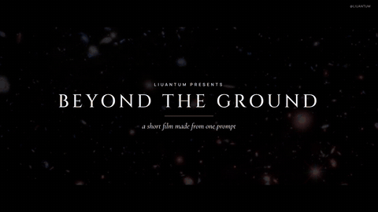
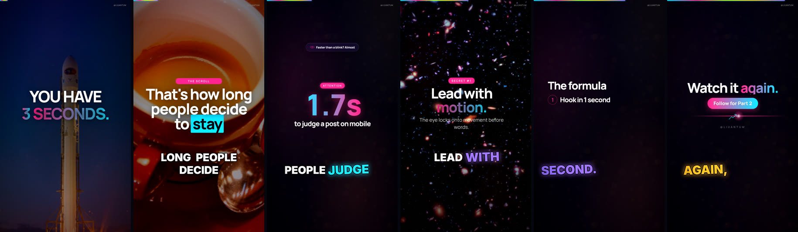
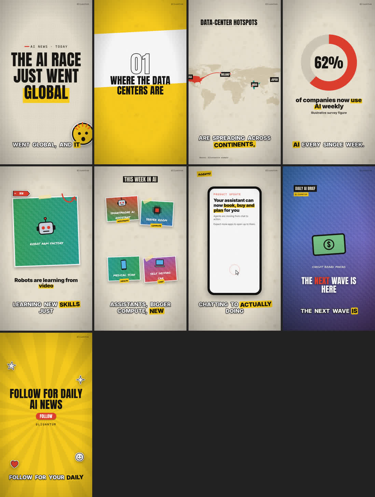

# 🎞️ Cinelume — one prompt → a viral short or a cinematic film

**An agent skill for Claude (Claude Code) and Google Antigravity** that turns a single prompt like

> *"Make a 60-second cinematic film about why the world depends on one island for its chips, for @liuantum"*

into a finished, ready-to-post MP4 — in one of two modes:

- **🔥 Viral shorts** (Reels / Shorts / TikTok): vivid colour themes, a 1-second hook, giant word-by-word coloured captions,
  gradient numbers, punch-in motion, cuts that land on the beat of generated trap/pop music, an energetic narrator run
  through a broadcast voice chain, and a retention progress bar.
- **🎬 Cinematic stories**: a finished **MP4 that feels like a documentary**: real photos and footage, film colour grading, 2.39:1 letterboxing,
light leaks and lens flares, elegant serif titles, frosted-glass annotations, fine-line callouts, a generated cinematic
score with braams and swells, and a **built-in neural narrator** — rendered frame-perfectly in headless Chrome.

<p align="center">&nbsp;&nbsp;</p>

<p align="center"></p>

<p align="center"></p>
<p align="center"></p>

▶️ Demos: [`docs/demo-viral.mp4`](docs/demo-viral.mp4) (9:16 viral short) · [`docs/demo-film.mp4`](docs/demo-film.mp4) (16:9 short film) · [`docs/demo-reel.mp4`](docs/demo-reel.mp4) (9:16 cinematic reel)
<sub>Demo photos: SpaceX launch photo (CC0), NASA Hubble Deep Field (public domain), coffee photo by Rachel Michetti (CC0). Demos were rendered offline, so they have score + sound design + captions but no narration.</sub>

---

## 🔥 Viral shorts mode

| | |
|---|---|
| **5 colour themes** | `neon` (pink/cyan/lime), `electric` (blue/acid lime), `sunset` (orange→pink→violet), `aurora` (mint/lavender), `candy` (bright light mode) |
| **Hook scene** | `hook` — 2–3 giant lines punch in word by word over a vivid shot with a bass drop, in the first second |
| **Captions as the hero** | `viral` captions: huge, outlined, each word pops in as it's spoken, every phrase gets a new colour with a glow |
| **Colour type** | `**word**` → gradient word · `==word==` → colour block highlight · numbers count up in gradient |
| **Music that drives the edit** | `auto:viral` (140-bpm trap: 808, claps, hat rolls, pluck hook), `auto:upbeat` (118 pop), `auto:phonk`, `auto:hype` — every cut is snapped to a beat and the camera pulses on the kick |
| **Voice** | `hype`, `hype-female`, `creator`, `indian-creator`, Hindi/Telugu/Tamil… + a broadcast chain (EQ, de-ess, compressor, limiter) on every voice, tight timing, music ducks under speech |
| **Retention details** | gradient progress bar, punch-in camera, fast whip/zoom/slit transitions with swooshes, glowing gradient "Follow for Part 2" CTA |

Ask: *"Make a viral 30-second Instagram reel about why sleep makes you smarter, neon theme, for @liuantum."*
Example: [`skills/cinelume/examples/viral-short.json`](skills/cinelume/examples/viral-short.json)

## What's new in Cinelume (v2)

Cinelume is the successor of `vox-video`. The flat "paper & cartoon sticker" explainer look is gone by default — every
video now looks and sounds like a film.

| | |
|---|---|
| **Real imagery, automatically** | `search:` / `search-video:` media pull the best-matching photo or footage across **Pexels → Unsplash → Pixabay → Openverse → Wikimedia Commons** (the last two need no API key). Results are scored for orientation, aspect and resolution; credits & licences are written next to the video. No result → an atmospheric light-and-bokeh plate, never a cartoon placeholder |
| **Film look** | 6 cinematic themes (`noir`, `film`, `midnight`, `ember`, `slate`, `ivory`), global colour grade (teal-orange, warm, cool, noir, bleach), graded photo looks, animated letterbox bars that slide in on story shots, light leaks, lens-flare sweeps, bokeh, vignette, fine grain |
| **5 new story scenes** | `opening` (film title card) · `establishing` (place + time typed over footage, optional camera viewfinder + REC timecode) · `cinematic` (full-bleed shot + film title, slit/blur reveals) · `narrative` (documentary intertitles) · `depth` (2.5D parallax plate with foreground cut-out and floating particles) |
| **Premium stickers** | 59 new: fine draw-on annotations (`ring`, `arrow-fine`, `leader` callouts, `corners`, `seal`), frosted-glass chips (`tag`, `stat`, `location`, `timestamp`, live `rec` timecode), light objects (`pulse`, `glint`, `flare`, `pin-glow`), real **photo stickers**, and 35 consistent line icons. The old cartoon set is kept only for classic themes |
| **Typography** | Cormorant Garamond (titles), Cinzel (film titles & places), Manrope (UI, numbers, captions) — all bundled (OFL) |
| **Camera & cuts** | +10 film camera moves (dolly, crane, truck, steadicam, parallax, reveal-pull…) and +9 film transitions (dissolve, cross-zoom, luma, light-leak, film-burn, lens-blur, dip-to-black/white, anamorphic slit) |
| **Sound** | generated **cinematic score** (`auto:cinematic`, `suspense` with heartbeat, `hopeful`, `epic` with taiko, `ambient`) with reverb; braams, impacts, swells, shimmer, typewriter keys; storyteller / documentary / trailer narrator voices |
| **Captions** | `cinema` (words brighten as they're spoken) and `subtitle` (film subtitles that sit inside the letterbox bar) |
| **Everything else still works** | all 20 original scene types (maps, charts, timelines, documents, screens…) are restyled automatically on cinematic themes; classic themes and the old storyboards still render unchanged |

## Install

Requirements: **Node 18+**, **ffmpeg**, and Chrome/Chromium/Edge (auto-detected; the installer can download Chromium).

```bash
git clone https://github.com/liuantum/cinelume.git
cd cinelume
./install.sh                # Claude Code + Antigravity, available in all projects
```
Windows: `powershell -ExecutionPolicy Bypass -File install.ps1`

| target | command | installs to |
|---|---|---|
| Claude Code only | `./install.sh claude` | `~/.claude/skills/cinelume` |
| Antigravity only | `./install.sh antigravity` | `~/.gemini/config/skills/cinelume` |
| One project (both agents) | `./install.sh all --project /path/to/repo` | `<repo>/.claude/skills/cinelume` and `<repo>/.agents/skills/cinelume` |

The installer removes an old `vox-video` install if it finds one.

**Claude Code plugin marketplace** (alternative):
```
/plugin marketplace add liuantum/cinelume
/plugin install cinelume@liuantum-cinelume
```

**Better images & footage (optional, all free):**
```bash
export PEXELS_API_KEY=...         # photos + real video footage  (pexels.com/api)
export UNSPLASH_ACCESS_KEY=...    # premium photography          (unsplash.com/developers)
export PIXABAY_API_KEY=...        # photos + video               (pixabay.com/api/docs)
```
Without keys, `search:` still finds openly-licensed photos on Openverse and Wikimedia Commons.

## Use

Ask your agent (in Antigravity you can type `/cinelume` to force it):

- *"A viral 30-second YouTube Short about the world's most expensive spice — sunset theme, female voice."*
- *"Make a 90-second cinematic documentary about the Strait of Hormuz and oil prices."*
- *"Turn this article into a 9:16 cinematic reel with a British narrator: <paste>"*
- *"A 2-minute film on the history of the transistor — midnight theme, epic music."*
- *"Daily AI story reel for @liuantum using these clips: ./footage/*.mp4"*

The agent researches → writes a story (cold open → question → world → rising → turn → resolution) → plans shots →
writes `storyboard.json` → validates → renders a contact sheet and **looks at it** → fixes → renders the MP4 → hands you
the video, the editable JSON and the media credits.

## Run the engine yourself

```bash
cd skills/cinelume/engine && npm install
node validate.mjs ../examples/silicon-island.json
node render.mjs  ../examples/silicon-island.json --stills auto       # PNG per scene + contact-sheet.jpg
node render.mjs  ../examples/ai-reel-cinematic.json --preview        # fast 540p draft
node render.mjs  ../examples/silicon-island.json --out island.mp4    # final 1080p
node render.mjs  ../examples/silicon-island.json --player            # scrub it live in a browser
```
Flags: `--format 9:16|16:9|1:1|4:5` · `--res 720|1080|2160` · `--fps 30|60` · `--voice documentary` · `--no-voice` · `--workers N` · `--crf N` · `--no-audio` · `--chrome PATH`.
Voices: `node tts.mjs --list` · try one: `node tts.mjs "Hello" hello.mp3 --voice storyteller`

A storyboard looks like this:

```json
{
  "meta": { "format": "16:9", "theme": "noir", "handle": "@you", "voice": "storyteller" },
  "audio": { "music": "auto:cinematic" },
  "scenes": [
    { "type": "opening", "presenter": "Liuantum presents", "title": "The Silicon Island",
      "tagline": "how one island came to power the world", "media": "search:taiwan coast fog dawn",
      "transition": "dip-black", "narration": "Every phone you have ever owned begins in one place." },
    { "type": "establishing", "location": "Hsinchu, Taiwan", "time": "04:12 AM", "viewfinder": true,
      "media": "search-video:semiconductor factory night aerial",
      "narration": "At four in the morning, the lights here never go out." },
    { "type": "bignumber", "value": 92, "suffix": "%", "label": "of leading-edge chip capacity sits in ==Taiwan==",
      "source": "BCG × SIA, 2021", "stickers": [{ "type": "glint", "x": 71, "y": 30, "size": 6, "at": 2.2 }] },
    { "type": "depth", "kicker": "The machine", "headline": "Each one is the size of a bus.",
      "media": "search:lithography machine cleanroom",
      "stickers": [{ "type": "leader", "text": "EUV scanner", "sub": "Veldhoven, NL", "x": 74, "y": 40, "size": 22, "at": 1.8 }] }
  ]
}
```
Full reference: [`skills/cinelume/references/storyboard-schema.md`](skills/cinelume/references/storyboard-schema.md)

## How it works

```
prompt ─► agent (SKILL.md: research · story · shot plan · cinematic rules)
            │
            ▼
      storyboard.json ──► validate.mjs (schema, markup, premium-sticker check, pacing)
            │
            ▼
      render.mjs ──► media: local / URL / Pexels · Unsplash · Pixabay · Openverse · Wikimedia (scored) → video frames
            │        neural narration per scene → scene timing fits the voice
            ▼
      runtime (HTML/CSS/SVG, deterministic seek(t)) in headless Chrome
            │  grade · letterbox · light leaks · parallax camera · N parallel workers → x264 segments
            ▼
      audio: cinematic score + sound design + voice → ducked, loudness-normalised mix
            ▼
      film.mp4  (+ credits.txt · stills / contact sheet · interactive player)
```

```
skills/cinelume/
├── SKILL.md                 # the agent instructions (Claude + Antigravity share the same format)
├── references/              # schema, cinematic bible, cameras & transitions, story/shot planning, stickers
├── examples/                # viral-short.json (9:16 viral), silicon-island.json (16:9 film), ai-reel-cinematic.json (9:16), classic/ (old style)
├── scripts/tts.py           # fallback text-to-speech engines
└── engine/
    ├── render.mjs           # CLI renderer + media search + score generator
    ├── validate.mjs         # storyboard validator
    ├── runtime/             # runtime.js, stickers.js, styles.css, worldmap.js
    └── assets/fonts/        # OFL fonts (Cormorant Garamond, Cinzel, Manrope, Inter, Anton, IBM Plex Mono…)
```

## Responsible use
The skill tells the agent to source real numbers (or label them *Illustrative*), not to fabricate quotes from real
people, not to dress invented stories in real outlets' branding, and not to search for or show identifiable private
people. Every downloaded image/clip keeps its author and licence in `<video>.credits.txt` — keep those credits when you publish.

## License
MIT © Liuantum. Fonts under SIL OFL 1.1; map data from Natural Earth (public domain).
