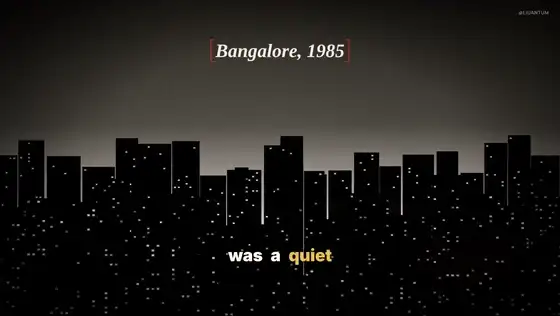
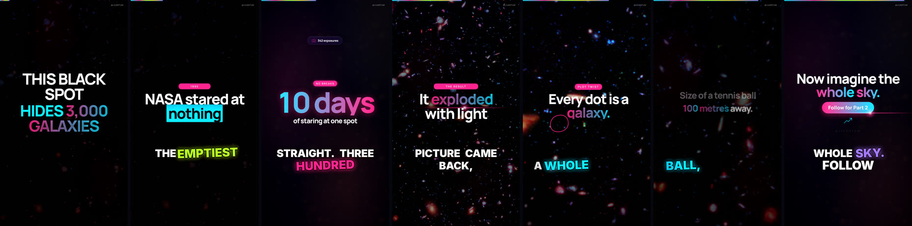
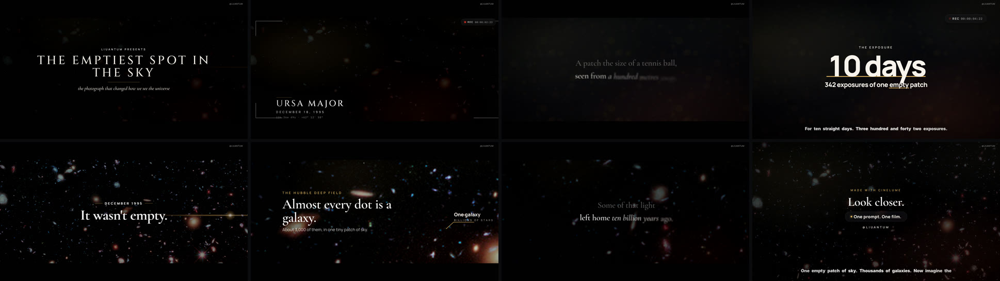

<div align="center">

# 🎞️ CINELUME

### One prompt → a finished, narrated video. Viral shorts or cinematic films.

An agent skill for **Claude Code** and **Google Antigravity** that researches, writes, directs, narrates, scores and renders a
ready-to-post MP4: real imagery, animated captions, beat-synced music and a natural neural voice.

[](#-see-it)
[](#-see-it)
[](#%EF%B8%8F-voices)
[](LICENSE)

</div>

---

## 👀 See it

Two demos made with Cinelume on one story: **the Hubble Deep Field**, the "empty" patch of sky that turned out to hold thousands of galaxies.
Both are fully narrated, scored and captioned. The previews below are silent loops; **click one to watch the MP4 with sound.**

<table>
<tr>
<td align="center" width="34%">

<a href="docs/deep-field-9x16.mp4"></a>

**9:16 · Viral short** · 23 s<br>
`neon` theme · viral captions · trap beat · studio voice<br>
<a href="docs/deep-field-9x16.mp4"><b>▶ Watch with sound</b></a>

</td>
<td align="center" width="66%">

<a href="docs/deep-field-16x9.mp4"></a>

**16:9 · Cinematic film** · 46 s<br>
`noir` theme · letterbox · subtitles · cinematic score · studio voice<br>
<a href="docs/deep-field-16x9.mp4"><b>▶ Watch with sound</b></a>

</td>
</tr>
</table>

<details>
<summary><b>🖼️ Every scene, frame by frame</b></summary>
<br>
<p align="center"></p>
<p align="center"></p>
</details>

**How they were made:** each demo is one storyboard JSON ([9:16](docs/demo-src/deep-field-9x16.json) · [16:9](docs/demo-src/deep-field-16x9.json))
rendered with `node render.mjs <storyboard>`. Narration, music, sound design, captions, camera moves and transitions are all generated by the engine.
Facts are from NASA / STScI.

---

## ✨ Two modes

<table>
<tr>
<th width="50%">🔥 Viral shorts</th>
<th width="50%">🎬 Cinematic stories</th>
</tr>
<tr valign="top">
<td>

For **Instagram Reels, YouTube Shorts, TikTok**
- **1-second hook**: giant words punch in over the strongest shot
- **Word-by-word captions**, outlined, every phrase in a new colour
- Gradient numbers, colour-block highlights, glowing CTA
- **Beat-synced editing**: every cut lands on the beat of generated
  trap / pop / phonk music, and the camera pulses on the kick
- Energetic narrator with a broadcast voice chain
- Retention progress bar, punch-in camera, fast transitions
- Themes: `neon` `electric` `sunset` `aurora` `candy`

</td>
<td>

For **documentaries, explainers, brand films**
- Real photos & footage, film colour grade
- Animated **2.39:1 letterbox**, light leaks, lens flares
- Serif & film-title typography, frosted-glass labels
- Story scenes: `opening`, `establishing`, `cinematic`, `narrative`, `depth` (2.5D parallax)
- Generated **cinematic score**: pads, drones, braams, swells
- Storyteller / documentary narrators, film subtitles
- Themes: `noir` `film` `midnight` `ember` `slate` `ivory`

</td>
</tr>
</table>

**Also in the box:** 27 scene types (maps that fly to countries, animated bar/line/donut charts, timelines, compare, lists, flows,
documents, phone/browser screens, b-roll montages…), 32 camera moves, 29 transitions, 59 premium stickers & line icons,
automatic real-image search with credits, and a deterministic renderer: what you preview is exactly what ships.

---

## 🚀 Quick start

**Requirements:** Node 18+, ffmpeg, and Chrome / Chromium / Edge (auto-detected; the installer can download Chromium).

```bash
git clone https://github.com/liuantum/cinelume.git
cd cinelume
./install.sh            # installs for Claude Code + Antigravity (all projects)
```

<details>
<summary>Other install options</summary>

| target | command | installs to |
|---|---|---|
| Windows | `powershell -ExecutionPolicy Bypass -File install.ps1` | same targets as below |
| Claude Code only | `./install.sh claude` | `~/.claude/skills/cinelume` |
| Antigravity only | `./install.sh antigravity` | `~/.gemini/config/skills/cinelume` |
| One project | `./install.sh all --project /path/to/repo` | `<repo>/.claude/skills/cinelume` + `<repo>/.agents/skills/cinelume` |

Claude Code plugin marketplace:
```
/plugin marketplace add liuantum/cinelume
/plugin install cinelume@liuantum-cinelume
```
</details>

Then just ask your agent:

> 💬 *"Make a viral 30-second reel about why the Hubble Deep Field changed astronomy, neon theme, for @liuantum."*
>
> 💬 *"A 60-second cinematic film about the Strait of Hormuz and oil prices, British narrator."*
>
> 💬 *"Turn this article into a 9:16 short with a Hindi voice: [paste article]"*

The agent researches → writes a hook-first script → plans shots → writes `storyboard.json` → validates → renders a contact sheet
and **looks at it** → fixes → renders the MP4 → hands you the video, the editable JSON and the image credits.

---

## 🖼️ Real images, automatically

Write `"media": "search:aerial city night rain"` or `"search-video:…"` and Cinelume finds the best-matching photo or clip for your frame:

**Pexels → Unsplash → Pixabay → Openverse → Wikimedia Commons** (the last two need no key) → otherwise an atmospheric light-and-bokeh plate.
Results are scored for orientation, aspect and resolution, and every author and licence is written to `<video>.credits.txt`.
Local files and URLs work too.

```bash
export PEXELS_API_KEY=...        # photos + real footage   (free: pexels.com/api)
export UNSPLASH_ACCESS_KEY=...   # premium photography     (free: unsplash.com/developers)
export PIXABAY_API_KEY=...       # photos + video          (free: pixabay.com/api/docs)
```

---

## 🎙️ Voices

Every scene's `narration` is spoken, captions sync to it, and scenes stretch to fit the voice. All voices go through a
broadcast chain (EQ, de-ess, compression, limiter) and the music ducks under speech.

| engine | voices | notes |
|---|---|---|
| **Edge neural** (default) | `hype` `hype-female` `creator` `creator-female` `storyteller` `documentary` `trailer` · Indian English, Hindi, Telugu, Tamil, UK, AU, ES, FR, DE… | no setup, needs internet while rendering |
| **Kokoro studio** (offline) | `studio-male` `studio-female` `studio-hype` `studio-deep` `studio-uk-male` `studio-uk-female` `studio-hindi-male` `studio-hindi-female`, or any `kokoro:<voice>` | the voices in the demos · `pip install kokoro-onnx soundfile` · downloads a ~120 MB model once |
| your own | `"voiceover": "my-take.mp3"` per scene or for the whole video | |

```bash
node skills/cinelume/engine/tts.mjs --list
node skills/cinelume/engine/tts.mjs "Hello there" hello.mp3 --voice studio-female
```

---

## 🛠️ Run the engine yourself

```bash
cd skills/cinelume/engine && npm install
node validate.mjs ../../../docs/demo-src/deep-field-9x16.json
node render.mjs  ../../../docs/demo-src/deep-field-9x16.json --stills auto    # PNG per scene + contact sheet
node render.mjs  ../examples/viral-short.json --preview                       # fast 540p draft
node render.mjs  ../examples/silicon-island.json --out film.mp4               # final 1080p
node render.mjs  ../examples/silicon-island.json --player                     # scrub live in a browser
```

Flags: `--format 9:16|16:9|1:1|4:5` · `--res 720|1080|2160` · `--fps 30|60` · `--voice studio-female` · `--no-voice` · `--workers N` · `--crf N` · `--no-audio`

<details>
<summary><b>What a storyboard looks like</b></summary>

```json
{
  "meta": { "format": "9:16", "theme": "neon", "handle": "@liuantum", "voice": "hype" },
  "audio": { "music": "auto:viral" },
  "scenes": [
    { "type": "hook", "lines": ["This black spot", "hides **3,000 galaxies**"], "media": "search:night sky dark",
      "narration": "This black spot hides three thousand galaxies." },
    { "type": "bignumber", "value": 10, "suffix": " days", "kicker": "No breaks", "label": "of staring at one spot",
      "source": "NASA / STScI", "stickers": [{ "type": "tag", "text": "342 exposures", "icon": "camera", "x": 50, "y": 20, "at": 1.4 }],
      "narration": "For ten days straight. Three hundred and forty two photos." },
    { "type": "depth", "kicker": "Plot twist", "headline": "Every dot is a **galaxy.**", "media": "search:hubble deep field galaxies",
      "narration": "Almost every dot you see is a whole galaxy, not a star." },
    { "type": "outro", "headline": "Now imagine the **whole sky.**", "cta": "Follow for Part 2",
      "narration": "Now imagine the whole sky. Follow for part two." }
  ]
}
```
Full reference: [`storyboard-schema.md`](skills/cinelume/references/storyboard-schema.md) ·
look & themes: [`style-bible.md`](skills/cinelume/references/style-bible.md) ·
stickers: [`stickers.md`](skills/cinelume/references/stickers.md) ·
camera & transitions: [`camera-and-transitions.md`](skills/cinelume/references/camera-and-transitions.md)
</details>

<details>
<summary><b>How it works</b></summary>

```
prompt ─► agent (SKILL.md: research · hook-first script · shot plan · style rules)
            │
            ▼
      storyboard.json ──► validate.mjs (schema, markup, stickers, pacing, hook checks)
            │
            ▼
      render.mjs ──► media search (Pexels · Unsplash · Pixabay · Openverse · Wikimedia) → scored, credited
            │        narration per scene (Edge neural / Kokoro studio) → scenes fit the voice → cuts snap to the beat
            ▼
      runtime (HTML/CSS/SVG, deterministic seek(t)) in headless Chrome
            │  grade · letterbox · light leaks · parallax camera · N parallel workers → x264
            ▼
      audio: generated music + sound design + processed voice → ducked, loudness-normalised (−15 LUFS)
            ▼
      video.mp4  (+ credits.txt · stills / contact sheet · interactive player)
```

```
skills/cinelume/
├── SKILL.md            # agent instructions (Claude + Antigravity)
├── references/         # schema, style bible, camera & transitions, shot planning, stickers
├── examples/           # viral-short.json, ai-reel-cinematic.json, silicon-island.json, classic/
├── scripts/            # kokoro_tts.py (studio voice), tts.py (fallback engines)
└── engine/             # render.mjs, validate.mjs, tts.mjs, runtime/, assets/fonts/
```
</details>

---

## 🤝 Responsible use

The skill tells the agent to source real numbers (or label them *Illustrative*), never fabricate quotes, never dress invented stories
in real outlets' branding, and avoid images of identifiable private people. Keep the credits in `<video>.credits.txt` when you publish.

## 📜 Credits & license

MIT © [Liuantum](https://github.com/liuantum).
Demo imagery: *Hubble Deep Field*, R. Williams (STScI), the HDF Team and NASA/ESA. Demo narration: [Kokoro-82M](https://github.com/thewh1teagle/kokoro-onnx) (Apache-2.0).
Fonts: Cormorant Garamond, Cinzel, Manrope, Inter, Anton, IBM Plex Mono (SIL OFL 1.1). Map data: Natural Earth (public domain).
