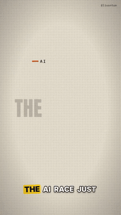
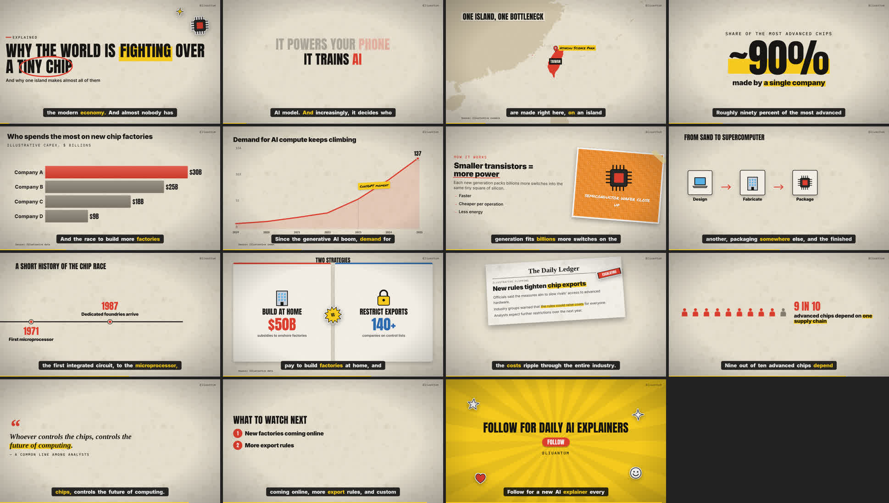

# 🎬 vox-video — one prompt → a finished Vox-style explainer video

**An agent skill for Claude (Claude Code) and Google Antigravity** that turns a single prompt like

> *"Make a 45-second vertical reel explaining why everyone is fighting over AI chips, Vox style, for @liuantum"*

into a polished **MP4** with camera moves, parallax, maps that fly to countries, animated charts,
hand-drawn highlights, die-cut stickers, b-roll, kinetic karaoke captions, sound effects, a music
bed and (optionally) a neural voiceover — rendered frame-perfectly in headless Chrome.

<p align="center">
  
  &nbsp;&nbsp;
  
</p>

<p align="center"></p>

▶️ Full demo: [`docs/demo-short.mp4`](docs/demo-short.mp4)

---

## Why it's different

Most "AI video" tools generate pixels and hope. This skill makes the agent work like a **motion
designer**: it researches, writes a script with the Vox arc (hook → context → mechanism →
evidence → stakes → payoff), shot-plans each beat into one of **20 purpose-built scene types**,
picks camera moves and transitions with intent, annotates the key words like a human with a
marker — then a deterministic engine renders it. Every frame is a pure function of time, so the
stills the agent previews are exactly what ships, and the result is editable JSON, not a black box.

| | |
|---|---|
| **20 scene types** | title · kinetic type · big number · bar chart · line chart · donut · icon grid · world **map** (fly-to, highlights, pins, animated routes) · photo · collage · newspaper/document · quote · timeline · A-vs-B compare · list · process flow · chapter card · browser/phone screen with cursor clicks · full-bleed b-roll montage · explain (text + media) · outro |
| **19 camera moves** | push-in, crash-zoom, pull-out, zoom-out-reveal, pan, tilt, **dolly-zoom (vertigo)**, orbit, handheld, whip-in, **rack-focus**, shake-hit, **3D tilt**, spiral-in… with 3-layer **parallax** and automatic **motion blur** |
| **20 transitions** | whip pans (with directional blur), paper-slide, stack, zoom-through, iris, circle-burst, paper **tear**, diagonal wipe, blinds, flash, glitch, spin, push, slide-up, fade, cut |
| **52 stickers & icons** | draw-on arrows / circles / underlines / checks, bursts & labels with text, sticky notes, tape, pins, emoji reaction faces, tech & money icons — all with die-cut white outline and pop/wiggle |
| **Marker annotations** | `==highlight==` · `**accent**` · `__underline__` · `[[circle]]` · `~~strike~~` · `{{box}}` drawn on, in sequence, with sound |
| **B-roll** | your own photos/videos (frame-synced), any URL, or `search:query` → Pexels/Pixabay stock (with a free API key) → otherwise designed illustrated placeholders, never blank frames |
| **Looks** | 7 themes (paper, dark, yellow, blueprint, red, navy, mint), paper texture, animated film grain, vignette, yellow **duotone** / halftone / B&W / vintage photo treatments |
| **Audio** | 14 synthesized SFX auto-cued to every event (whooshes, pops, scribbles, dings, booms…), generated lo-fi music bed (or your track) with **auto-ducking**, loudness-normalised mix, optional TTS voiceover (edge-tts / gTTS / macOS say / espeak) |
| **Formats** | 16:9, 9:16, 1:1, 4:5 · 720p → 4K · any fps · captions: karaoke / boxed / minimal |
| **Agent-proof** | JSON validator with actionable errors, auto text-fitting, zoom-aware safe areas, `--stills auto` contact sheet so the agent *looks* at its work before the final render |

## Install

Requirements: **Node 18+**, **ffmpeg**, and Chrome/Chromium/Edge (auto-detected; the installer can download Chromium).

```bash
git clone https://github.com/liuantum/vox-video-skill.git
cd vox-video-skill
./install.sh                # Claude Code + Antigravity, available in all projects
```
Windows: `powershell -ExecutionPolicy Bypass -File install.ps1`

| target | command | installs to |
|---|---|---|
| Claude Code only | `./install.sh claude` | `~/.claude/skills/vox-video` |
| Antigravity only | `./install.sh antigravity` | `~/.gemini/config/skills/vox-video` (+ legacy Antigravity folders if present) |
| One project (both agents) | `./install.sh all --project /path/to/repo` | `<repo>/.claude/skills/vox-video` and `<repo>/.agents/skills/vox-video` |

**Claude Code plugin marketplace** (alternative):
```
/plugin marketplace add liuantum/vox-video-skill
/plugin install vox-video@liuantum-vox-video
```
(then run `npm install` once inside the skill's `engine/` folder, or just let the agent do it — the skill tells it to.)

Optional extras:
```bash
pip install edge-tts                 # free natural voiceover  → "meta": {"voice": "edge:en-US-AndrewNeural"}
export PEXELS_API_KEY=...            # real stock photos/videos for "search:..." media (free key at pexels.com/api)
export PIXABAY_API_KEY=...           # alternative stock source
```

## Use

Just ask your agent (Claude Code, or Antigravity — type `/vox-video` to force it):

- *"Make a 60-second Vox-style explainer about how the Strait of Hormuz affects oil prices."*
- *"Turn this article into a 9:16 reel with captions and voiceover: <paste>"*
- *"Create a 2-minute dark-theme video on the history of the transistor, with a timeline and a map."*
- *"Daily AI news reel for @liuantum using these clips: ./footage/*.mp4"*

The agent will: write the script → plan shots → write `storyboard.json` → validate → render a
contact sheet and inspect it → fix → render the MP4 → hand you the video and the editable JSON.

## Run the engine yourself

```bash
cd skills/vox-video/engine && npm install
node validate.mjs ../examples/ai-chip-war.json
node render.mjs  ../examples/ai-news-short.json --stills auto       # PNG per scene + contact-sheet.jpg
node render.mjs  ../examples/ai-news-short.json --preview           # fast 540p draft
node render.mjs  ../examples/ai-chip-war.json --out chip.mp4        # final 1080p
node render.mjs  ../examples/ai-chip-war.json --player              # scrub it live in a browser
```
Flags: `--format 9:16|16:9|1:1|4:5` · `--res 720|1080|2160` · `--fps 30|60` · `--workers N` · `--crf N` · `--no-audio` · `--chrome PATH`.

A storyboard looks like this:

```json
{
  "meta": { "format": "9:16", "theme": "paper", "captions": "karaoke", "handle": "@you" },
  "audio": { "music": "auto:tense" },
  "scenes": [
    { "type": "title", "kicker": "AI news", "headline": "The AI race just went ==global==",
      "camera": "crash-zoom", "transition": "whip-up",
      "narration": "The AI race just went global.",
      "stickers": [{ "type": "face-mindblown", "x": 78, "y": 70, "size": 18, "at": 1.2 }] },
    { "type": "map", "title": "Data-center hotspots",
      "highlight": ["USA", "Ireland", "India", "Japan"],
      "arcs": [{ "from": [-77, 39], "to": [-6.3, 53.3] }],
      "narration": "New data centers are spreading across continents." },
    { "type": "bignumber", "value": 62, "suffix": "%", "label": "of companies ==use AI== weekly",
      "source": "Illustrative", "camera": "push-in" }
  ]
}
```
Full reference: [`skills/vox-video/references/storyboard-schema.md`](skills/vox-video/references/storyboard-schema.md)

## How it works

```
prompt ─► agent (SKILL.md: research · script · shot plan · style rules)
            │
            ▼
      storyboard.json ──► validate.mjs (schema, markup, sticker names, pacing)
            │
            ▼
      render.mjs ──► resolve media (local / URL / stock API / placeholder, video → frames)
            │        TTS per scene (optional) → scene timing fits the voice
            ▼
      runtime (HTML/CSS/SVG, deterministic seek(t)) in headless Chrome
            │  N parallel workers × CDP screenshots → x264 segments
            ▼
      audio: SFX cue sheet + music bed + voice → ducked, loudness-normalised mix
            ▼
      video.mp4  (+ stills / contact sheet / interactive player)
```

```
skills/vox-video/
├── SKILL.md                 # the agent instructions (Claude + Antigravity share the same format)
├── references/              # schema, camera & transitions, shot planning, stickers, style bible
├── examples/                # ai-chip-war.json (16:9, every scene), ai-news-short.json (9:16 reel)
├── scripts/tts.py           # multi-engine text-to-speech
└── engine/
    ├── render.mjs           # CLI renderer
    ├── validate.mjs         # storyboard validator
    ├── runtime/             # runtime.js, stickers.js, styles.css, worldmap.js
    └── assets/fonts/        # OFL fonts (Anton, Inter, Permanent Marker, IBM Plex Mono, Playfair)
```

## Responsible use
The skill tells the agent to source real numbers (or label them *illustrative*), not to fabricate
quotes from real people, not to dress invented stories in real outlets' branding, and not to put
photos of identifiable people in videos unless you supplied them. Stock media keeps its provider
credits in `<video>.credits.txt`.

## License
MIT © Liuantum. Fonts under SIL OFL 1.1; map data from Natural Earth (public domain).
