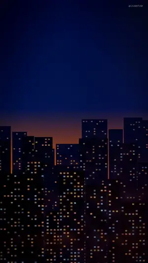

<div align="center">

# 🎞️ CINELUME

### One prompt → a finished, narrated video.
#### Vox-edit documentaries · viral shorts · cinematic films

An agent skill for **Claude Code** and **Google Antigravity** that researches a topic, writes the script, plans the shots,
narrates, scores and renders a ready-to-post MP4, in vertical **9:16** or widescreen **16:9**.

[](#-see-it)
[](#-see-it)
[](#-see-it)
[](#%EF%B8%8F-voices)
[](LICENSE)

</div>

---

## 👀 See it

**The City That Codes**: how Bengaluru went from a quiet "pensioners' paradise" to home of more than a million tech workers,
starting with a satellite dish that arrived on a bullock cart in 1985. Both cuts are fully narrated, scored and captioned,
rendered from a single storyboard file each.

<table>
<tr>
<td align="center" width="34%">

<a href="docs/bengaluru-9x16.mp4"></a>

**9:16 · Reel / Short** · 35 s<br>
<a href="docs/bengaluru-9x16.mp4"><b>▶ Watch with sound</b></a>

</td>
<td align="center" width="66%">

<a href="docs/bengaluru-16x9.mp4"></a>

**16:9 · YouTube documentary** · 63 s<br>
<a href="docs/bengaluru-16x9.mp4"><b>▶ Watch with sound</b></a>

</td>
</tr>
</table>

<sub>Previews are silent loops; click to play the MP4 with narration and music.
Storyboards: [9:16](docs/demo-src/bengaluru-9x16.json) · [16:9](docs/demo-src/bengaluru-16x9.json).
Facts: Texas Instruments, CBRE Global Tech Talent Guidebook 2025, Government of Karnataka, RBI, Deccan Herald.
The city backdrops in these demos are generated illustrations; in normal use Cinelume pulls real photos and footage for every shot.</sub>

<details>
<summary><b>🖼️ Every scene, frame by frame</b></summary>
<br>
<p align="center"></p>
<p align="center"></p>
</details>

---

## ✨ Three styles

<table>
<tr>
<th width="33%">📼 Vox edit</th>
<th width="33%">🔥 Viral shorts</th>
<th width="33%">🎬 Cinematic</th>
</tr>
<tr valign="top">
<td>

Documentary collage, as in the demos above.
- Grid paper, film grain, archival B&W prints
- **Automatic cut-outs** of people & objects
- Props: **old TV**, **clipboard** with typed notes, taped prints, **magnifying glass**
- `[in 1985]` year brackets, italic name labels, **red boxes** with yellow serif words, colour spots
- Big caption words timed to the voice
- Hand-drawn red circles, arrows & underlines
- Themes: `archive` `newsroom`

</td>
<td>

Bright, fast and loud.
- **1-second hook** over the strongest shot
- Giant **word-by-word captions**, each phrase a new colour
- Gradient numbers, colour highlights, glowing CTA
- **Beat-synced cuts** on generated trap / pop / phonk music; camera pulses on the kick
- Retention progress bar, punch-in camera, whip transitions
- Themes: `neon` `electric` `sunset` `aurora` `candy`

</td>
<td>

Film-like and calm.
- Real footage with a film colour grade
- Animated **2.39:1 letterbox**, light leaks, lens flares
- Serif & film-title typography, glass labels
- Title cards, place/time stamps, 2.5D parallax
- Orchestral-style generated score
- Themes: `noir` `film` `midnight` `ember` `slate` `ivory`

</td>
</tr>
</table>

**Vox animation in every style:** stickers land with an overshoot pop, a confetti burst and a gentle wiggle; markers draw
themselves on; photos drop in as taped polaroids. 32 glossy die-cut stickers (fire, rocket, rupee, Indian flag, trend arrows,
modern 3D faces, speech bubbles, sticky notes…), plus fine-line annotations, glass tags and 35 line icons.

**Also in the box:** 28 scene types (maps that fly to countries, animated bar / line / donut charts, timelines, compare, lists,
flows, documents, phone & browser screens, b-roll), 32 camera moves, 29 transitions, 20 themes, automatic real-image search
with credits, and a deterministic renderer, so what you preview is exactly what ships.

---

## 🚀 Quick start

**Requirements:** Node 18+, ffmpeg, and Chrome / Chromium / Edge (auto-detected; the installer can download Chromium).

```bash
git clone https://github.com/liuantum/cinelume.git
cd cinelume
./install.sh            # installs for Claude Code + Antigravity (all projects)
```

<details>
<summary>Other install options</summary>

| target | command | installs to |
|---|---|---|
| Windows | `powershell -ExecutionPolicy Bypass -File install.ps1` | same targets as below |
| Claude Code only | `./install.sh claude` | `~/.claude/skills/cinelume` |
| Antigravity only | `./install.sh antigravity` | `~/.gemini/config/skills/cinelume` |
| One project | `./install.sh all --project /path/to/repo` | `<repo>/.claude/skills/cinelume` + `<repo>/.agents/skills/cinelume` |

Claude Code plugin marketplace:
```
/plugin marketplace add liuantum/cinelume
/plugin install cinelume@liuantum-cinelume
```

Optional extras:
```bash
pip install kokoro-onnx soundfile   # offline studio voices (used in the demos)
pip install rembg                   # automatic cut-outs for Vox-edit collages
```
</details>

Then just ask your agent:

> 💬 *"Make a Vox-edit reel about how Bengaluru became India's IT capital, for @liuantum."*
>
> 💬 *"A viral 30-second YouTube Short about the world's most expensive spice, sunset theme, female voice."*
>
> 💬 *"A 60-second cinematic film about the Strait of Hormuz and oil prices, British narrator."*
>
> 💬 *"Turn this article into a 9:16 Vox-edit short with a Hindi voice: [paste article]"*

The agent researches → writes a hook-first script → plans shots → writes `storyboard.json` → validates → renders a contact sheet
and **looks at it** → fixes → renders the MP4 → hands you the video, the editable storyboard and the image credits.

---

## 🖼️ Real images, automatically

Write `"media": "search:old bangalore street"` or `"search-video:…"` and Cinelume finds the best-matching photo or clip for the frame:

**Pexels → Unsplash → Pixabay → Openverse → Wikimedia Commons** (the last two need no key) → otherwise an atmospheric backdrop.
Results are scored for orientation, aspect and resolution, and every author and licence is written to `<video>.credits.txt`.
Prefix any media with `cutout:` to remove its background (people, objects) for collage shots. Local files and URLs work too.

```bash
export PEXELS_API_KEY=...        # photos + real footage   (free: pexels.com/api)
export UNSPLASH_ACCESS_KEY=...   # premium photography     (free: unsplash.com/developers)
export PIXABAY_API_KEY=...       # photos + video          (free: pixabay.com/api/docs)
```

---

## 🎙️ Voices

Every scene's `narration` is spoken, captions sync to it word by word, and scenes stretch to fit the voice. All voices go through
a broadcast chain (EQ, de-ess, compression, limiter), the music ducks under speech, and the mix is loudness-normalised for social.

| engine | voices | notes |
|---|---|---|
| **Kokoro studio** (offline) | `studio-male` `studio-female` `studio-hype` `studio-deep` `studio-uk-male` `studio-uk-female` `studio-hindi-male` `studio-hindi-female`, or any `kokoro:<voice>` | the voices in the demos · `pip install kokoro-onnx soundfile` · ~120 MB model downloads once |
| **Edge neural** (default) | `hype` `hype-female` `creator` `creator-female` `storyteller` `documentary` `trailer` · Indian English, Hindi, Telugu, Tamil, UK, AU, ES, FR, DE… | no setup, needs internet while rendering |
| your own | `"voiceover": "my-take.mp3"` per scene or for the whole video | |

```bash
node skills/cinelume/engine/tts.mjs --list
node skills/cinelume/engine/tts.mjs "Hello there" hello.mp3 --voice studio-female
```

---

## 🛠️ Run the engine yourself

```bash
cd skills/cinelume/engine && npm install
node validate.mjs ../examples/vox-edit-reel.json
node render.mjs  ../examples/vox-edit-reel.json --stills auto       # one PNG per scene + contact sheet
node render.mjs  ../examples/vox-edit-reel.json --preview           # fast 540p draft
node render.mjs  ../examples/vox-edit-reel.json --out reel.mp4      # final 1080p
node render.mjs  ../examples/vox-edit-reel.json --player            # scrub it live in a browser
```

Flags: `--format 9:16|16:9|1:1|4:5` · `--res 720|1080|2160` · `--fps 30|60` · `--voice studio-female` · `--no-voice` · `--workers N` · `--crf N` · `--no-audio`
<br><sub>On 8 GB machines use `--workers 2` for long Vox-edit videos.</sub>

| example | style | format |
|---|---|---|
| [`vox-edit-reel.json`](skills/cinelume/examples/vox-edit-reel.json) | Vox edit | 9:16 |
| [`viral-short.json`](skills/cinelume/examples/viral-short.json) | Viral short | 9:16 |
| [`silicon-island.json`](skills/cinelume/examples/silicon-island.json) | Cinematic | 16:9 |
| [`ai-reel-cinematic.json`](skills/cinelume/examples/ai-reel-cinematic.json) | Cinematic | 9:16 |

<details>
<summary><b>What a storyboard looks like</b></summary>

```json
{
  "meta": { "format": "9:16", "theme": "archive", "handle": "@liuantum", "voice": "studio-male" },
  "audio": { "music": "auto:suspense" },
  "scenes": [
    { "type": "story", "frame": "full", "media": "search:bangalore 1980s street black and white", "year": "in 1985",
      "narration": "In 1985, Bangalore was a quiet city of gardens." },
    { "type": "story", "text": "a pensioners' **paradise.**",
      "narration": "People called it a pensioners' paradise." },
    { "type": "story", "frame": "print", "media": "search:bullock cart india", "tag": "bullock cart", "tagAt": 2.2,
      "stickers": [{ "type": "circle", "x": 50, "y": 38, "size": 30, "at": 2.6, "color": "#C2271E" }],
      "narration": "Its satellite dish arrived on a ==bullock cart.==" },
    { "type": "story", "frame": "tv", "media": "search-video:bangalore tech park aerial",
      "narration": "Glass tech parks rose where the fields used to be." },
    { "type": "bignumber", "value": 1000000, "suffix": "+", "label": "tech workers in ==one city==", "source": "CBRE, 2025",
      "narration": "Today, more than a million tech workers live in this one city." },
    { "type": "outro", "headline": "Bengaluru.", "cta": "Follow for Part 2",
      "narration": "Bengaluru. Follow for part two." }
  ]
}
```
Full reference: [`storyboard-schema.md`](skills/cinelume/references/storyboard-schema.md) ·
look & themes: [`style-bible.md`](skills/cinelume/references/style-bible.md) ·
stickers: [`stickers.md`](skills/cinelume/references/stickers.md) ·
camera & transitions: [`camera-and-transitions.md`](skills/cinelume/references/camera-and-transitions.md)
</details>

<details>
<summary><b>How it works</b></summary>

```
prompt ─► agent (SKILL.md: research · hook-first script · shot plan · style rules)
            │
            ▼
      storyboard.json ──► validate.mjs (schema, markup, stickers, pacing, hook checks)
            │
            ▼
      render.mjs ──► media search (Pexels · Unsplash · Pixabay · Openverse · Wikimedia) → scored, credited, optional cut-outs
            │        narration per scene (Kokoro studio / Edge neural) → scenes fit the voice → cuts snap to the beat
            ▼
      runtime (HTML/CSS/SVG, deterministic seek(t)) in headless Chrome, one browser per worker → x264
            ▼
      audio: generated music + sound design + processed voice → ducked, loudness-normalised (−15 LUFS)
            ▼
      video.mp4  (+ credits.txt · stills / contact sheet · interactive player)
```

```
skills/cinelume/
├── SKILL.md            # agent instructions (Claude + Antigravity)
├── references/         # schema, style bible, camera & transitions, shot planning, stickers
├── examples/           # vox-edit-reel, viral-short, silicon-island, ai-reel-cinematic, classic/
├── scripts/            # kokoro_tts.py (studio voice), cutout.py (background removal), tts.py (fallbacks)
└── engine/             # render.mjs, validate.mjs, tts.mjs, runtime/, assets/fonts/
```
</details>

---

## 🤝 Responsible use

The skill tells the agent to source real numbers (or label them *Illustrative*), never fabricate quotes, never dress invented
stories in real outlets' branding, and avoid images of identifiable private people. Keep the credits in `<video>.credits.txt`
when you publish.

## 📜 Credits & license

MIT © [Liuantum](https://github.com/liuantum).
Demo narration: [Kokoro-82M](https://github.com/thewh1teagle/kokoro-onnx) (Apache-2.0). Background removal: [rembg](https://github.com/danielgatis/rembg) (MIT).
Fonts: Cormorant Garamond, Playfair Display, Cinzel, Manrope, Inter, Anton, IBM Plex Mono, Permanent Marker (SIL OFL 1.1 / Apache-2.0). Map data: Natural Earth (public domain).
